# 09. Web UI

Web UI работает через тот же REST API, что CLI, TUI и интеграции: всё, что сделано здесь
мышкой, можно повторить командой `mp` или в TUI, и наоборот — это на каждой сборке
проверяет тест `internal/parity` ([01](01-architecture.md#11-тестирование)). Интерфейс на
русском и английском, со светлой и тёмной темой; на телефоне меню выезжает сбоку, а
таблицы становятся карточками. Долгие операции — установка пакетов, применение конфигов,
выпуск сертификатов, бэкапы — идут задачами: страница не ждёт, прогресс и лог видны в
«Задачах».

Перед тем, что удаляет, останавливает или перезаписывает, страница спрашивает и
объясняет, что произойдёт; удаление аккаунта и удаление сайта вместе с файлами требуют
ещё и набрать его имя. Администратор видит все страницы. Обычный аккаунт видит дашборд —
нагрузку и службы сервера, без диагностики, — а на страницах сайтов, «Аккаунта», баз
данных, почты, файлов, задач, журнала и настроек только своё.

Скриншоты сняты с тестового сервера: Ubuntu 24.04, MonoPanel 0.8.10, сайты на
example.com. Как их переснять — [в конце страницы](#как-переснять-скриншоты).

## Вход

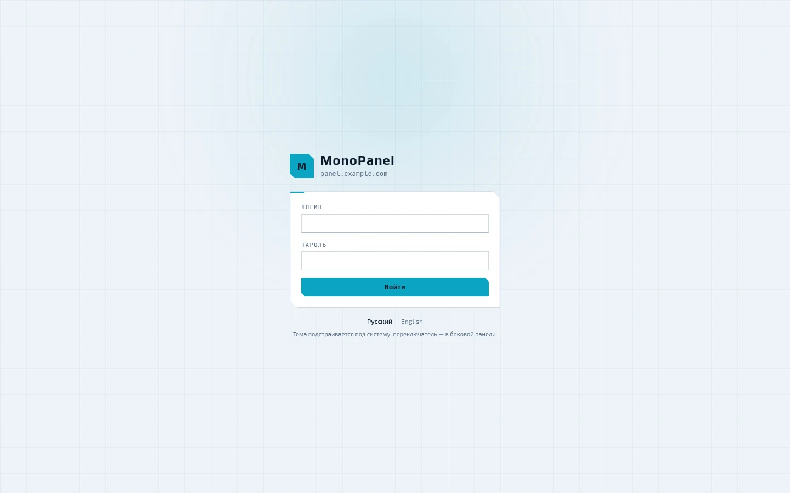

Панель слушает свой порт — 8443 — со своим сертификатом и не зависит от системного nginx.
Язык переключается прямо на экране входа, тема повторяет системную. Если у аккаунта
включена двухфакторная аутентификация, после пароля панель спросит код из приложения.

## Дашборд

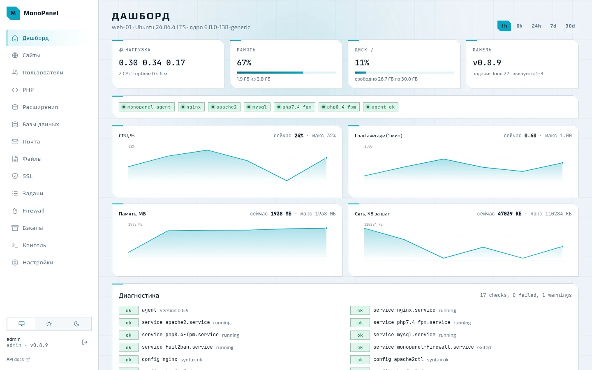

Нагрузка, память и swap, диски и панель — версия, время работы, задачи по статусам (клик
открывает их список) и число аккаунтов; ниже — состояние сервисов и графики CPU, load
average, памяти, занятого диска, приёма и отдачи сети за час, шесть часов, сутки, неделю
или месяц. Кнопка «таблица» показывает те же точки списком, как `mp metrics`. Если агент
не отвечает, вверху об этом предупреждение. У администратора сервис из списка
открывается на странице «Службы», а внизу — диагностика, то же, что `mp doctor`:
сервисы, синтаксис конфигов, диск, память, сертификаты, DNS, задачи и дрейф
сгенерированных файлов. Подробности находки раскрываются по клику, проверку можно
запустить заново. У части находок рядом есть кнопка: «починить» сайт или все сайты,
«вернуть enforcing» для SELinux.

## Сайты

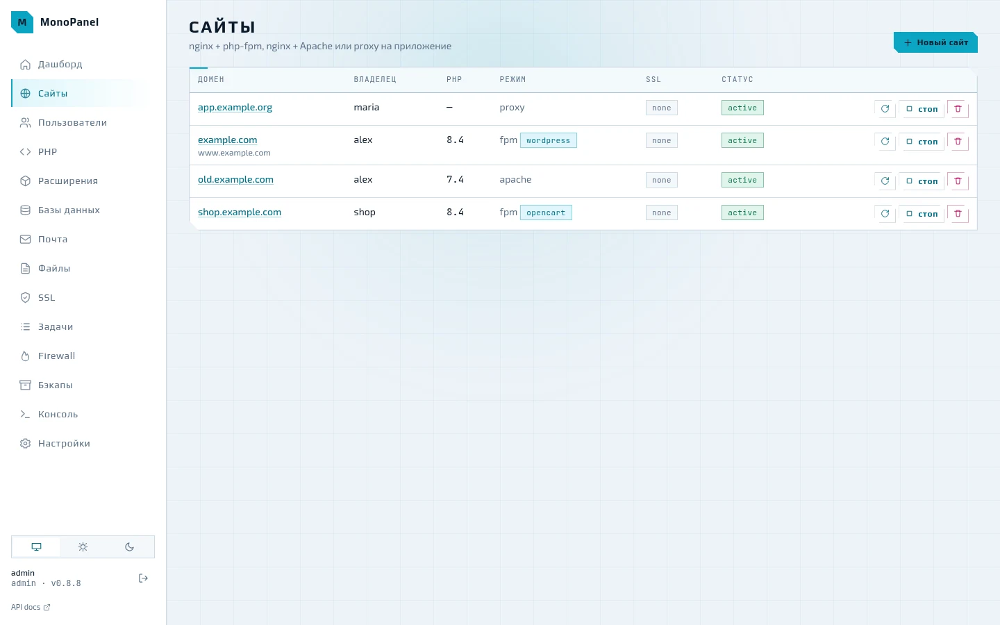

В списке — владелец, ветка PHP, режим и пресет CMS (и сама CMS, если её ставила панель),
адреса IPv4 и IPv6, SSL и статус. Сайт можно применить заново, приостановить — вместо
него отдаётся страница 503 — и удалить; приостанавливает и включает администратор, а
удаление вместе с файлами просит набрать домен.

В форме нового сайта — домен, владелец (у администратора), режим, PHP и пресет, а под
«Ещё настройки» — остальные поля `mp site add`: алиасы, подкаталог docroot, редирект
www, адреса IPv4 и IPv6 (авто, без IPv6 или свой адрес), `client_max_body_size`, `pm` и
`max_children` пула php-fpm, лимит запросов в секунду с одного адреса, доступ только с
перечисленных IP, PHP-параметры строками `key=value` и флаги редиректа на HTTPS (+HSTS),
HTTP/2, HTTP/3, статики через nginx (режим apache), exec/system и заголовков
безопасности. Кнопка «Сменить IP» (администратор) переносит одной задачей все сайты с
одного адреса этого сервера на другой — когда у сервера сменился адрес; с пустым
«Откуда» переезжают сайты с адресов, которых на сервере больше нет.

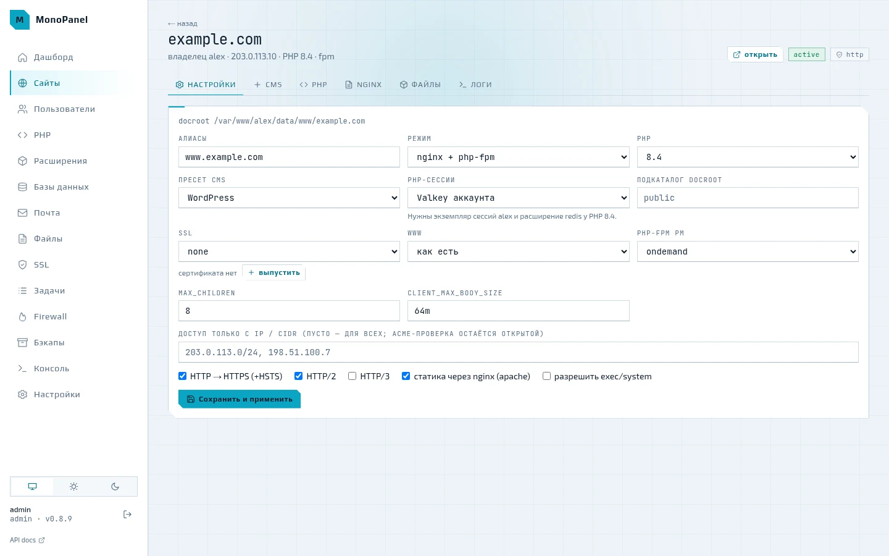

Карточка сайта — вкладки «Настройки», «CMS», «PHP», «nginx», «Файлы» и «Логи», а в
шапке — «применить», «починить файлы» (владелец, права, ACL и метки SELinux, как
`mp site fix`), остановка и включение (администратор) и «JSON» — запись сайта целиком,
как `mp site show`. Последняя ошибка применения видна над вкладками. В настройках —
алиасы, режим (nginx → php-fpm, nginx → Apache или прокси на приложение), ветка PHP,
пресет CMS, где PHP хранит сессии (файлы или Valkey аккаунта), подкаталог docroot, SSL с
состоянием сертификата (администратор выпускает его отсюда: HTTP-01 или DNS-01 через
DNS-провайдера), редирект www, пул php-fpm, `client_max_body_size`, адреса IPv4 и IPv6,
лимит запросов, доступ только с перечисленных IP и флаги HTTP/2, HTTP/3, HSTS, статики
через nginx, exec/system и заголовков безопасности. «Сохранить и применить» отправляет
только изменённые поля и ставит задачу:
конфиги рендерятся заново, проверяются `nginx -t`, `apachectl -t` и `php-fpm -t` и
записываются все сразу — или не записываются вовсе, если проверка не прошла.

На вкладке «CMS» панель ставит в сайт WordPress, Joomla, OpenCart или 1С-Битрикс
(редакция и решение) — как это устроено, в [03](03-web-stack.md#10-установка-cms);
пароль администратора CMS показывается один раз. «PHP» — действующие параметры с
источником каждого (панель, глобально, пресет, сайт) и переопределения сайта, сохранение
перезапускает пул. «nginx» — свои директивы внутри `server {}` с проверкой `nginx -t` и
откатом (меняет и удаляет их администратор) и сгенерированный server-блок для чтения.
«Логи» — access, error, php, slow и логи Apache, от 50 до 5000 последних строк.

## PHP

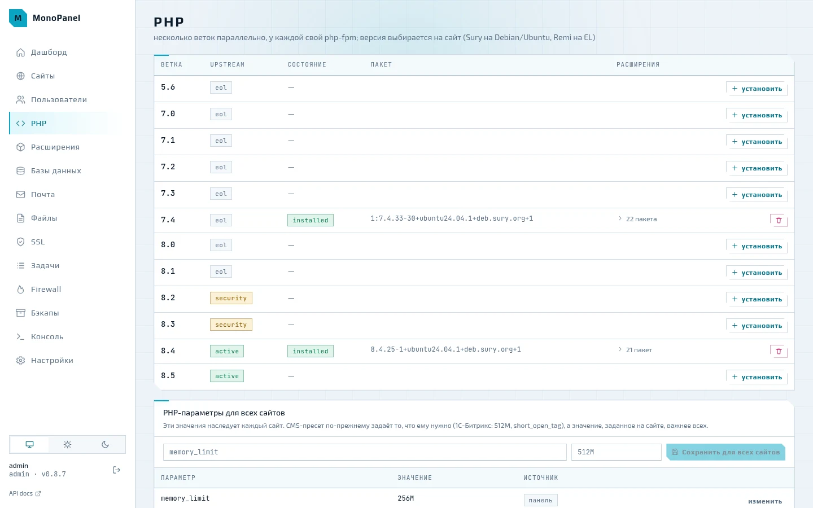

Все ветки от 5.6 до 8.5 с их статусом у разработчиков PHP — eol, security, active; ветку
можно поставить и удалить, а сорвавшуюся установку — повторить. У установленной ветки
раскрывается список расширений, их можно включать и выключать; пунктирные есть в
репозитории, но не установлены — клик ставит пакет и включает расширение. Ниже —
PHP-параметры для всех сайтов: значение наследует каждый сайт, пресет CMS задаёт то, что
нужно ему, а заданное на самом сайте важнее всего. «Несколько сразу» правит их списком
строк `key=value`: пулы всех сайтов пересобираются один раз, а не на каждый ключ.

## Расширения

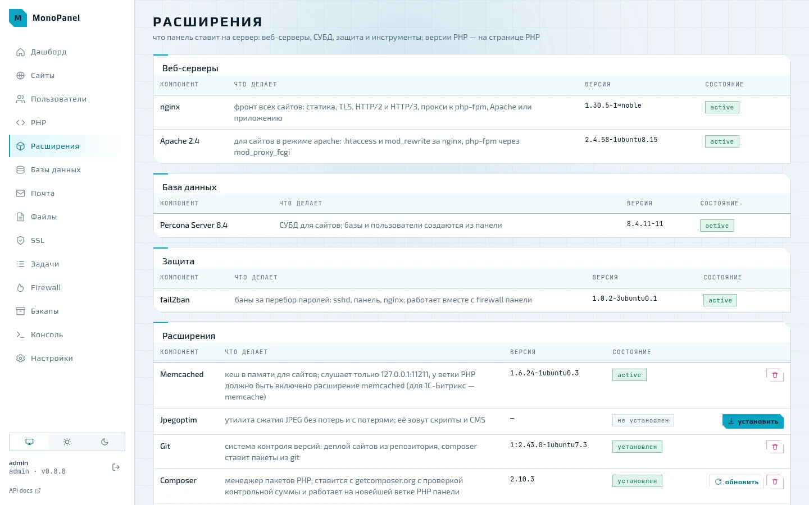

Всё, что панель ставит на сервер помимо PHP: nginx и Apache, Percona Server или MySQL,
fail2ban, memcached, Valkey, jpegoptim, git, composer и Sphinx для 1С-Битрикс — с версией,
состоянием службы и кнопками установки; инструменты можно и удалить. Установленный
компонент можно переустановить — так чинят сломавшийся, а composer так обновляется;
сорвавшуюся установку можно повторить, причина сбоя видна в строке. Ветки PHP
перечислены здесь же с состоянием их php-fpm, а управляются на странице PHP. У memcached
здесь же настраиваются память и число соединений.

## Базы данных

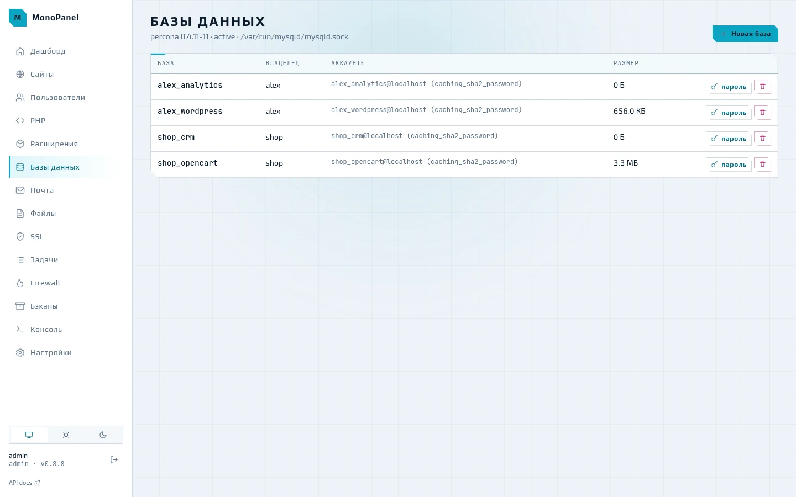

Базы называются `<логин>_<имя>` (MySQL ограничивает имя 32 символами, форма показывает
его целиком), у каждой свой пользователь MySQL. Пароль генерируется так, чтобы пройти
`validate_password`, или задаётся свой; новый пароль ставится прямо из списка, и
сгенерированный показывается один раз. Плагин аутентификации выбирается при создании: по
умолчанию `mysql_native_password`, если у владельца есть сайт на PHP ниже 7.4, иначе
`caching_sha2_password`; включить `mysql_native_password` на сервере — это перезапуск
MySQL — может только администратор. Над таблицей — какая СУБД стоит, где её сокет и
включён ли `mysql_native_password`; пока сервера баз нет, администратор ставит отсюда
Percona Server или MySQL 8.4. Ниже у администратора — параметры MySQL: значения панели,
рассчитанные под память хоста, и заданные вручную, как `mp db config`; сохранение
перезапускает MySQL после проверки конфигурации, а «перенастроить под сервер»
пересчитывает значения панели.

## Почта

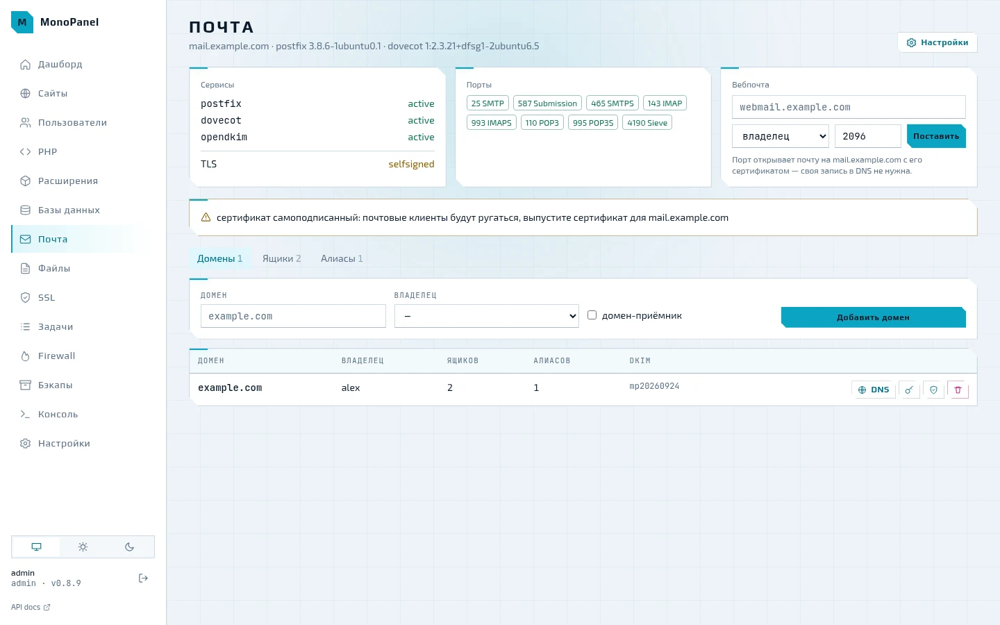

Состояние postfix, dovecot и opendkim, сертификат, открытые порты (и занятые чужим
демоном), вебпочта Roundcube, домены, ящики и алиасы; ящики и алиасы можно показать по
одному домену. Кнопка DNS у домена показывает, какие MX, SPF, DKIM, DMARC и PTR
прописать, и проверяет их по публичным резолверам. В строке домена — новый ключ DKIM,
«только отправка», домен-приёмник, выключение и удаление; у ящика — правка имени, квоты
(0 — без лимита), пароля и состояния, новый случайный пароль и удаление, по желанию
вместе с письмами; у алиаса — правка адресов пересылки. Администратор ставит почтовый
сервер, меняет его настройки, применяет конфигурацию заново («Применить сейчас») и
ставит вебпочту или переустанавливает её поверх — база Roundcube с контактами и
настройками пользователей при этом остаётся. Если почтовый сервер работает на
самоподписанном сертификате, панель об этом предупреждает. Подробнее —
[06. Почтовый сервер](06-mail.md).

## Файлы

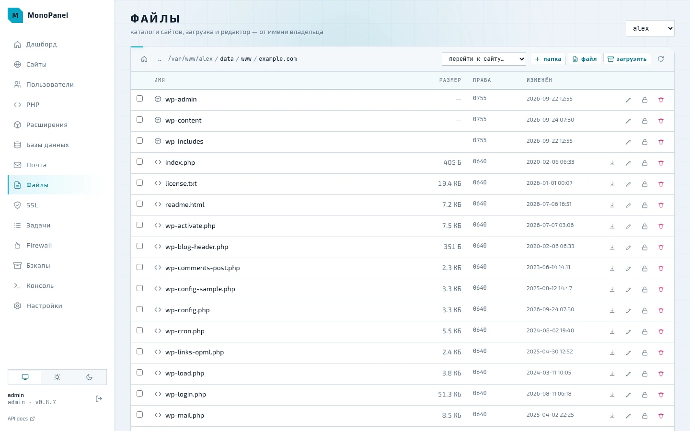

Файлы открываются от имени владельца: панель видит в них ровно то же, что и он сам.
Загрузка (в том числе перетаскиванием), новые файлы и папки, переименование и перенос по
другому пути, права, распаковка zip и tar (tar.gz), скачивание, удаление — и нескольких
сразу, — переход по пути или к каталогу сайта и размер папки по запросу; символьная
ссылка на каталог открывается как каталог. Администратор выбирает аккаунт, а на странице
сайта вкладка «Файлы» сразу открывает его docroot.

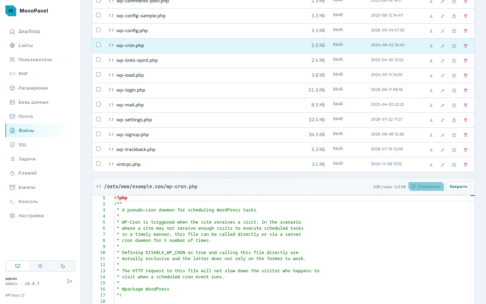

Текстовый файл открывается в редакторе VS Code (Monaco): подсветка php, html, css, js, sql,
yaml и ini, поиск и замена, мультикурсор, свёртка, палитра команд по F1.

## SSL

Все сертификаты сервера на одной странице администратора. Вверху — сертификат самой
панели: самоподписанный, выпущенный по ACME (HTTP-01 или DNS-01, ключ ECDSA P-256 или
RSA-2048, по желанию staging) или импортированный; его можно продлить или вернуть
самоподписанный. Пока у панели нет имени, только адрес, выпустить его нельзя — имя
задаётся в настройках. Ниже — сайты: каким сертификатом отдаётся HTTPS и все ли имена
сайта он покрывает, издатель и срок; сертификат сайта выпускается, импортируется
(купленный или корпоративный, с цепочкой; PEM вставляют текстом или из файла) и
продлевается из строки. Let's Encrypt-сертификат панель дальше продлевает сама, любой
другой — нет: новый ставится так же, импортом.
«Другие сертификаты» — те, что не отдают ни панель, ни сайты, например почтового хоста:
их заказывают на любые имена, wildcard — через DNS-01, у Let's Encrypt, в его staging или
в другой ACME-директории, импортируют и удаляют. Внизу — DNS-провайдеры для DNS-01:
поля — переменные lego этого провайдера, значения хранятся зашифрованными и больше не
показываются. «Продлить все» сразу заказывает новые ACME-сертификаты, «Подробнее»
показывает имена, серийный номер, срок, последнюю попытку и кто сертификат отдаёт.

## Задачи

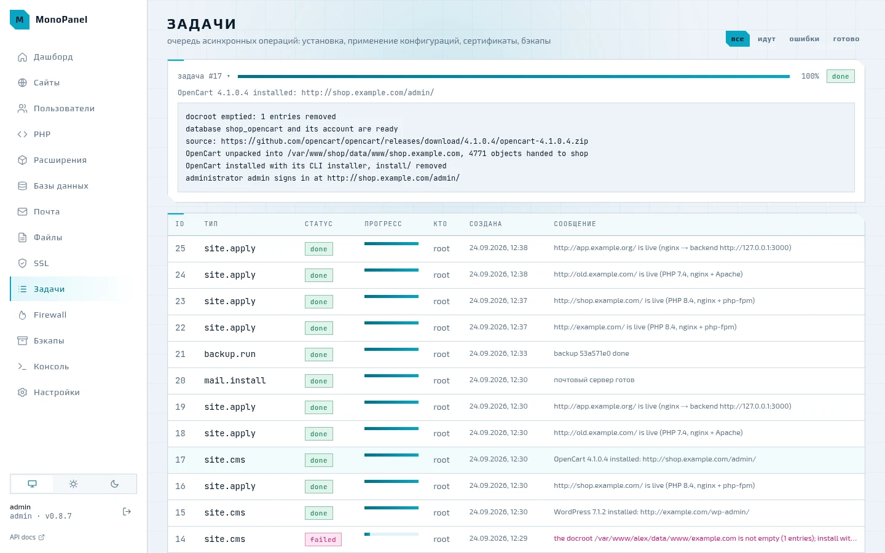

Всё, что меняет сервер, идёт очередью задач: установка пакетов, применение сайтов, выпуск
сертификатов, бэкапы. Список фильтруется по статусу и числу последних задач (до 500), а
задача за его пределами открывается по номеру. По клику открываются её объект, время,
параметры и лог — живой, пока задача идёт; пароли, токены и секреты в параметрах не
показываются. Упавшая задача остаётся в списке с текстом ошибки. Администратор видит все
задачи, аккаунт — те, что запускал сам.

## Журнал

Кто и откуда входил в панель (в том числе неудачно), кто выпускал токены, кто что менял,
чьи запросы к локальному сокету отклонены. Администратор видит всё, аккаунт — только
свои записи. Фильтры — входы, токены, отказы, аккаунт (у администратора), начало
действия (`auth.`, `token.`, `site.`…) и число последних записей; клик по аккаунту или
действию в таблице фильтрует по нему, клик по подробностям раскрывает их целиком. То же
самое — `mp audit`, а для разбора инцидентов файлами — `/var/log/monopanel/audit.log`
строками JSON.

## Firewall

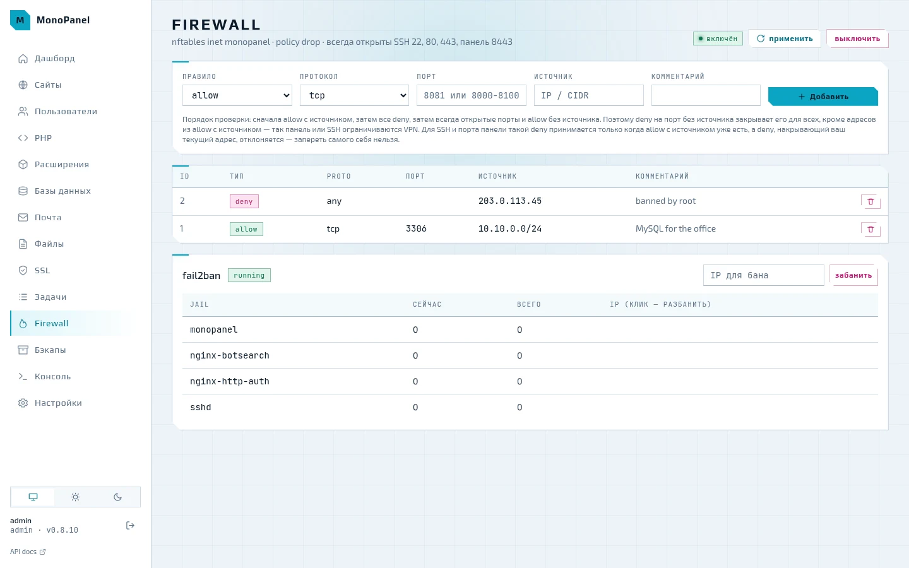

Правила nftables поверх политики drop, SSH, 80, 443 и порт панели открыты всегда. Правила
allow с источником проверяются раньше deny, поэтому порт можно закрыть для всех, кроме
своей сети или VPN, а правило, которое заперло бы вас самих, панель не примет. Правило —
allow или deny, протокол, порт или диапазон, источник и комментарий; закрытые порты и
кому они открыты видны тегами. Firewall применяется заново, включается и выключается
кнопками вверху, а если его таблица nftables не загружена, страница предупреждает. Ниже —
jail'ы fail2ban и их баны, адрес снимается с бана кликом; адрес можно и забанить или
разбанить вручную (бан — запрещающее правило firewall панели, свой адрес забанить
нельзя), а если fail2ban не установлен, он ставится отсюда же. Под ними — доверенные адреса:
их fail2ban не банит, сюда вписывают офис и адреса администраторов; список хранится и
до установки fail2ban.

## Службы

Юниты systemd, за которыми следит панель, — агент, веб-серверы, сервер баз данных и
php-fpm всех установленных веток PHP — с состоянием, автозапуском и временем запуска;
любой другой юнит сервера открывается по имени (postfix, dovecot, fail2ban, таймер или
сокет). У юнита — запустить, остановить, перезапустить, перечитать конфигурацию
(reload) или «перечитать или перезапустить», включить или выключить автозапуск, как
`mp service …`, и журнал systemd: число последних строк, фильтр по тексту, обновление
каждые 5 секунд. Перед остановкой страница говорит, что перестанет работать: у nginx —
все сайты, у сервера баз — базы, у `monopanel-api` и агента — сама панель; перезапуск
панели страница переживает и переподключается сама. Страница — администратора.

## Бэкапы

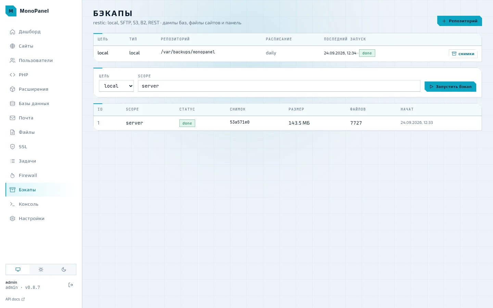

Репозитории restic — локальный каталог, SFTP, S3, B2 или REST-сервер — с ежедневным
расписанием (весь сервер) или запуском вручную и хранением по дням, неделям и месяцам;
пароль репозитория генерируется и показывается один раз, учётные данные S3, B2 и REST
хранятся зашифрованными. Бэкап запускается на весь сервер, аккаунт, сайт или базу;
снимок восстанавливается рядом, в `/var/lib/monopanel-agent/restore/<снимок>` (каталог
только для root), или на место — по выбранным путям в веб-корне, конфигурации панели,
сертификатах, учётной записи ACME и дампах и после явного согласия. Ниже — история запусков, по всем репозиториям
или по одному, с размером и числом файлов. Репозиторий можно забыть: панель перестанет в
него писать и забудет его пароль, а снимки в нём останутся — прочитать их можно, добавив
репозиторий снова с тем же паролем.

## Перенос

Переезд аккаунта между серверами, страница администратора; как он устроен — в
[07. Перенос между панелями](07-migration.md). Вкладка «Отдать аккаунт» — на старой
MonoPanel: аккаунт, срок от 1 до 168 часов, «Выдать токен». Панель показывает свой
адрес, аккаунт, токен (один раз) и готовую команду `mp migrate plan …`, а ниже — токены
переноса, которые выдал этот администратор: когда выдан, до какого времени действует,
пользовалась ли им уже новая панель; отзывают токен, как только переезд закончен.
Вкладка «Принять аккаунт» — на новом сервере. Источник — другая MonoPanel (адрес, аккаунт и токен; строка
`mp migrate plan …`, вставленная в поле адреса, заполняет форму сама), FASTPANEL или
BitrixVM (ssh от root: пароль, приватный ключ или оба, у BitrixVM — ещё домен основного
сайта), и при нужде другой логин здесь. «Проверить» показывает разбор, ничего не меняя:
что мешает — со ссылкой туда, где это исправляют, — предупреждения, заметки источника,
отпечаток ключа его ssh-хоста, сайты (их свои директивы nginx — кнопкой «свой nginx»:
панель их не применит, а сохранит для проверки), базы, почту, сертификаты, весь
переносимый crontab, app-сервисы и Valkey. «Перенести аккаунт» ставит задачу, а после неё
страница даёт строки `curl --resolve` и `hosts`, чтобы проверить сайты до переключения
DNS; аккаунту с чужой панели она напоминает задать пароль для входа в панель.

## Консоль

Команды `mp` от имени администратора с выводом по ходу выполнения: тот же бинарник и те
же команды, что по SSH, кнопки частых команд, история и кнопка «прервать». Каждая команда
получает одноразовый токен — он живёт, пока она идёт, но не дольше 30 минут; адрес панели
и токен она получает через окружение, а пароли и токены, набранные в строке, — на stdin, а
не в командной строке; в журнале действий и в эхо команды их значения скрыты. Служебные
роли бинарника (`api`, `agent`, `helper`, `fsop`, `update-run`, `app-exec`), `setup`,
`update trust` и то, что читает или пишет файлы на сервере (`files get|put`,
`ssl import`, `ssl panel import`, `site nginx --set`, `migrate --key`), из консоли
недоступны — то же делают страницы панели.

## Пользователи

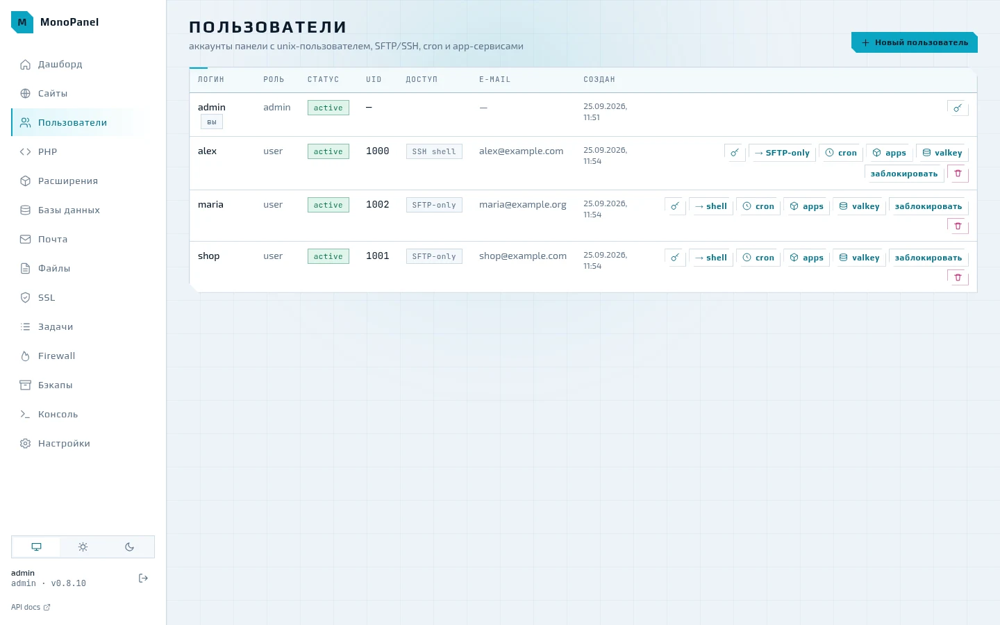

Аккаунт панели — это unix-пользователь со своим домашним каталогом: доступ по SFTP
(chroot) или SSH, задания cron (их можно добавлять, править на месте и выключать) и app-сервисы — фоновые приложения вроде бота или бэкенда на
Node и Python под systemd, с журналом, подробностями и правкой на месте. Пароль общий
для панели и SFTP; его можно сгенерировать, а смена пароля завершает сессии аккаунта в
браузерах — его API-токены продолжают работать. Новый аккаунт — логин, пароль, e-mail,
роль, квота (пока только хранится) и доступ по SSH. В строке аккаунта — карточка
(e-mail, UID, домашний каталог, сброс 2FA), пароль, переключение SFTP ↔ shell, cron, app-сервисы,
Valkey, общие папки, API-токены, блокировка (вход в панель и по SFTP/SSH закрывается,
сессии завершаются, сайты, базы и cron продолжают работать) и удаление с набором логина.
Вкладки «Cron», «App-сервисы» и «Valkey» показывают то же сразу по всем аккаунтам.
Удаление аккаунта убирает и его сайты, базы, cron, app-сервисы, экземпляры Valkey и
сертификаты, а с галочкой — и домашний каталог со всеми файлами.

Кнопка «папки» — общие папки: каталог сайта другого аккаунта, смонтированный в дом этого
аккаунта. Гость видит его после входа по SFTP и ничего больше, файлы читают и пишут оба
аккаунта и веб-сервер, а галочка «без PHP» не даёт сайту выполнять загруженные туда
скрипты. Галочка «точка входа» (и кнопка «вход» в таблице) — сессия SFTP начинается сразу в этой
папке, а не в доме. Так подрядчику или сервису обмена дают одну папку сайта, не отдавая аккаунт.

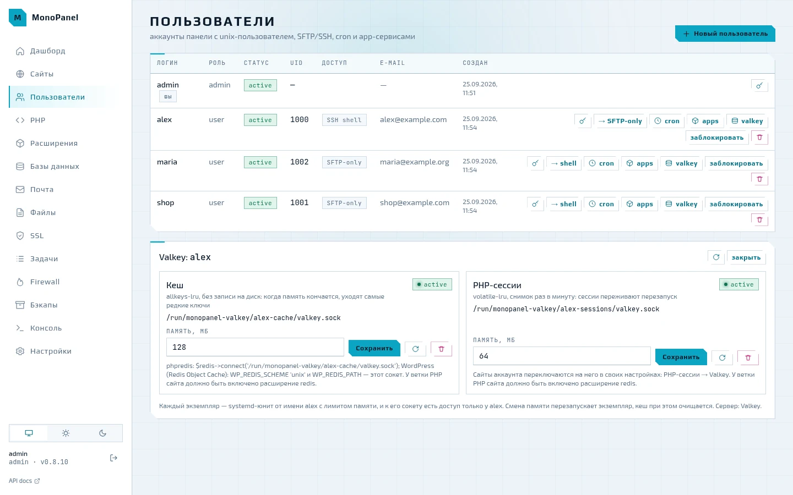

Кнопка valkey открывает два экземпляра Valkey аккаунта — для кеша и для PHP-сессий. Каждый
работает от имени аккаунта с лимитом памяти и слушает только свой unix-сокет: путь и
подсказка, как подключить phpredis или WordPress, показаны тут же. Сайт переводит сессии в
Valkey у себя в настройках — поле «PHP-сессии».

## Аккаунт

Обычный аккаунт видит вместо «Пользователей» страницу «Аккаунт» — своё и ничего больше.
Вверху — карточка: логин, роль, доступ (SFTP или SSH), e-mail (его можно поменять), UID,
домашний каталог и смена пароля (другие сессии в браузерах завершатся, эта останется).
Ниже — вкладки «Cron», «App-сервисы» и «Valkey» с теми же действиями, что у
администратора, но только для себя, «Общие папки» — папки сайтов других аккаунтов,
выданные этому (выдаёт и отбирает их администратор), и «API-токены».
Двухфакторная аутентификация — в «Настройках».

## Настройки

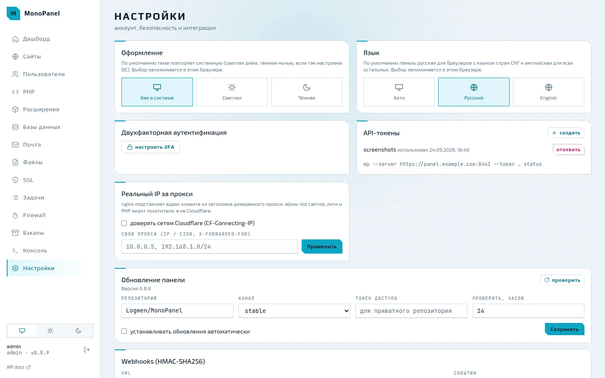

Тема и язык, двухфакторная аутентификация с QR-кодом для приложения (и ключом для ручного
ввода) — выключить её можно только паролем аккаунта, а настроить заново — только после
выключения, — и API-токены для CLI и интеграций: название, срок и метки. У администратора
ещё карточка «Панель» — имя панели (`web.hostname`), адрес и порт (`web.listen`), сколько
задач идёт одновременно (`jobs.workers`), уровень и формат журнала (`log.level`,
`log.format`) из `config.yaml`. Они начинают действовать после перезапуска
`monopanel-api`, который можно сделать сразу; если меняется адрес панели, страница
заранее показывает новый и команду, которой вернуть прежнее значение от root. Ниже —
обновление панели (проверка, установка новой или любой другой версии, репозиторий,
канал, токен, расписание и автоустановка; ключ подписи релизов меняется только на
сервере, `mp update trust`), webhooks с подписью HMAC-SHA256 и тестовой отправкой,
доверенные прокси для настоящего адреса посетителя (сети Cloudflare встроены), режим
SELinux на EL и список шаблонов конфигураций — какие из них переопределены файлами в
`/etc/monopanel/templates/`.

## Как переснять скриншоты

Скриншоты снимаются с настоящей панели на машине [площадки](08-testbed.md), наполненной
учебными данными: `scripts/screenshots/seed.sh` ставит последний релиз той же командой,
что и в README, поднимает стек и заводит аккаунты, сайты с WordPress и OpenCart, базы,
cron, почту, firewall и бэкап на example.com; адреса сайтов — из диапазона для
документации. `scripts/screenshots/capture.mjs` открывает панель в headless Chrome по
временному API-токену и снимает каждую страницу в светлой и тёмной теме в `docs/img/`;
с `--lang en` — английский интерфейс в `docs/en/img/` для английской документации.

```bash
make testbed-reset VM=ubuntu2404
ssh mp-ubuntu2404 sh -s < scripts/screenshots/seed.sh
node scripts/screenshots/capture.mjs --ssh mp-ubuntu2404          # все страницы
node scripts/screenshots/capture.mjs --ssh mp-ubuntu2404 jobs     # только одну
node scripts/screenshots/capture.mjs --lang en --ssh mp-ubuntu2404  # английские
```

Рядом с каждым снимком лежит тёмный вариант (`<имя>.dark.webp`): на сайте документации
показывается тот, что совпадает с выбранной темой, на GitHub — светлый.
