# 09. Web UI

The web UI works through the same REST API as the CLI, the TUI and integrations: anything
done here with the mouse can be repeated with an `mp` command or in the TUI, and vice
versa — the `internal/parity` test checks this on every build
([01](01-architecture.md#11-testing)). The interface is in English and Russian, with a
light and a dark theme; on a phone the menu slides in from the side and tables become
cards. Long operations — installing packages, applying configs, issuing certificates,
backups — run as jobs: the page does not wait, and the progress and the log are visible
in "Jobs".

Before anything that deletes, stops or overwrites, the page asks and explains what will
happen; deleting an account, and deleting a site together with its files, also asks you
to type its name. An administrator sees every page. An ordinary account sees the
dashboard — the server's load and services, without the diagnostics — and, on the
sites, "Account", databases, mail, files, jobs, audit log and settings pages, only its
own things.

The screenshots were taken on a sample server — Ubuntu 24.04, MonoPanel 0.8.10, sites on
example.com. How to retake them: [at the end of the page](#how-to-retake-the-screenshots).

## Sign-in

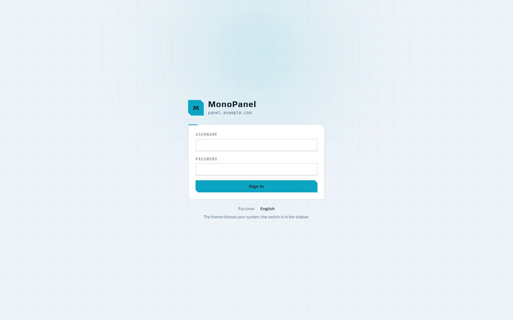

The panel serves its own port — 8443 — with its own certificate and does not depend on the
system nginx. The language can be switched right on the sign-in screen, and the theme
follows the system one. If two-factor authentication is enabled for the account, the panel
asks for the code from the authenticator app after the password.

## Dashboard

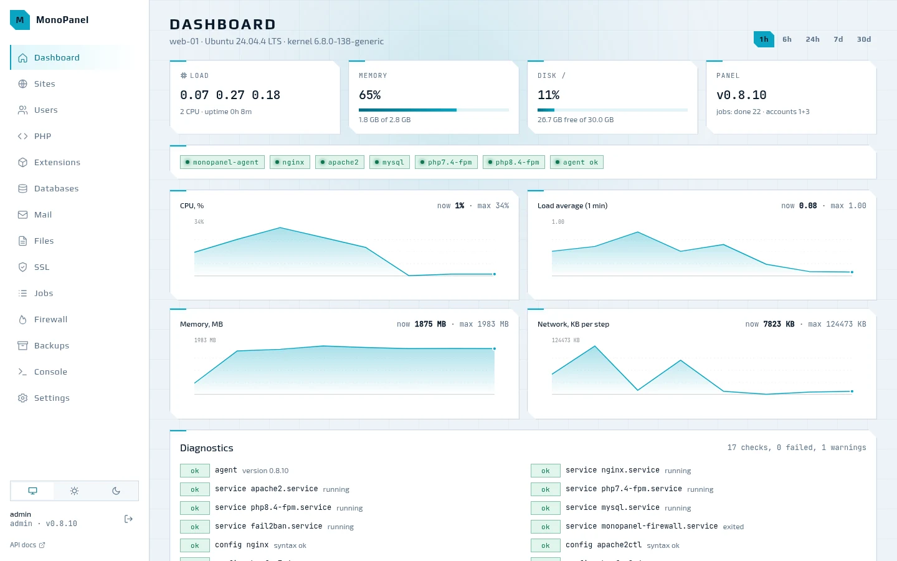

Load, memory and swap, the disks and the panel — its version, uptime, jobs by status (a
click opens their list) and the number of accounts; below them, the state of the services
and charts of CPU, load average, memory, used disk, and network received and sent over an
hour, six hours, a day, a week or a month. The "Table" button shows the same points as a
list, like `mp metrics`. If the agent does not answer, a warning says so at the top. For
an administrator a service in the list opens on the "Services" page, and at the bottom
are the diagnostics, the same as `mp doctor`: services, config syntax, disk, memory,
certificates, DNS, jobs, drift of generated files, restic's sandbox, the shared folders,
the panel port's socket, the stack's package updates that wait, kernel modules and the
moves of the upgrade to 0.9.0. A finding's details expand on a click, and the checks
can be run again. Some findings have a button next to them:
fix a site or "Fix all sites", "Back to enforcing" for SELinux; findings about waiting
updates, and about nginx, PHP, Apache and database services on a binary an upgrade
replaced, have a "To the upgrade" link to the Extensions page.

## Sites

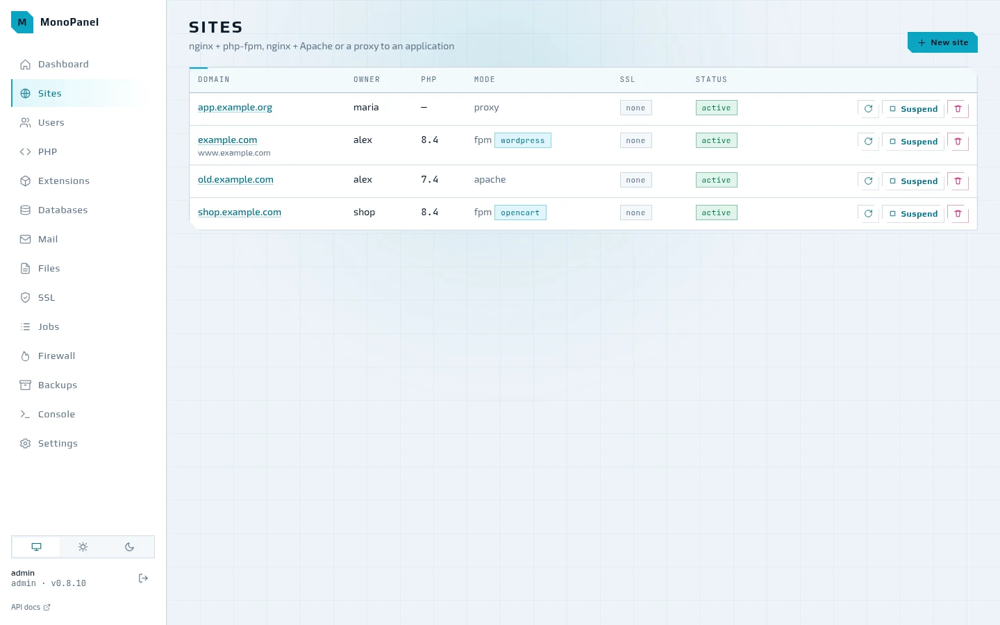

The list shows the owner, the PHP branch, the mode and CMS preset (and the CMS itself if
the panel installed it), the IPv4 and IPv6 addresses, SSL and the status. A site can be
applied again, suspended — a 503 page is served in its place — and deleted; suspending
and enabling is for administrators, and deleting with the files asks you to type the
domain.

The new site form has the domain, the owner (for an administrator), the mode, PHP and the
preset, and under "More settings" the rest of `mp site add`'s fields: aliases, the docroot
subdirectory, the www redirect, the IPv4 and IPv6 addresses (automatic, no IPv6 or an
address of your own), `client_max_body_size`, the php-fpm pool's `pm` and
`max_children`, a limit of requests per second from one address, access only from the
listed IPs, PHP settings as `key=value` lines, and the flags for the HTTPS redirect
(+HSTS), HTTP/2, HTTP/3, static files through nginx (apache mode), exec/system and the
security headers. The "Change IP" button (administrators) moves every site from one
address of this server to another in a single job — for when the server's address has
changed; with "From" left empty, the sites on addresses the server no longer has move.

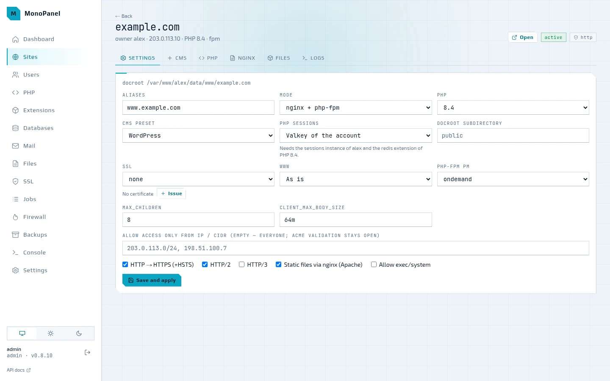

The site page has the "Settings", "CMS", "PHP", "nginx", "Files" and "Logs" tabs, and its
header has "Apply", "Fix files" (owner, modes, ACLs and SELinux labels, like
`mp site fix`), suspending and enabling (administrators) and "JSON" — the whole site
record, like `mp site show`. The last apply error is shown above the tabs. The settings
cover the aliases, the mode (nginx → php-fpm, nginx → Apache or a proxy to an
application), the PHP branch, the CMS preset, where PHP keeps sessions (files or the
account's Valkey), the docroot subdirectory, SSL with the certificate's state (an
administrator issues it from here: HTTP-01, or DNS-01 through a DNS provider), the www
redirect, the php-fpm pool, `client_max_body_size`, the IPv4 and IPv6 addresses, the
request limit, access only from the listed IPs and the HTTP/2, HTTP/3, HSTS, static files
through nginx, exec/system and security header flags. "Save and apply" sends only the
fields that changed and queues a job: the configs are rendered again, checked with
`nginx -t`, `apache2 -t` (the configuration of the account's Apache) and `php-fpm -t` and
written all at once — or not written at all if the check fails.

On the "CMS" tab the panel installs WordPress, Joomla, OpenCart or 1C-Bitrix (edition and
solution) into the site — how that works is in [03](03-web-stack.md#10-cms-installation);
the CMS administrator's password is shown once. "PHP" lists the effective settings with
the source of each (panel, global, preset, site) and the site's overrides; saving
restarts the pool. "nginx" holds your own directives inside `server {}`, checked with
`nginx -t` and rolled back on error (an administrator changes and removes them), and the
generated server block to read. Directives the panel does not take (`fastcgi_pass` to
anything but the site's pool, `fastcgi_param PHP_VALUE` and others —
[03 §3](03-web-stack.md#3-nginx-template-mode-a-abridged)) are refused before anything is
written, and the message says so — "the panel does not take these directives (nothing
was changed)" — rather than blaming nginx. "Logs" shows access, error, php, slow and the Apache logs,
from the last 50 to 5000 lines (for a site that has not moved out of `data/logs` since the
upgrade to 0.9.0, from the file written last: the one in `~/data/logs`, read as the
account, or the log tree's).

## PHP

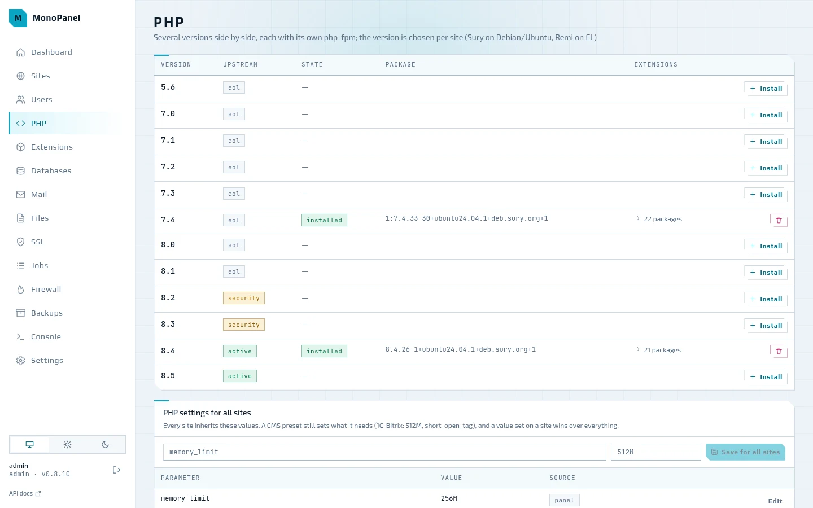

Every branch from 5.6 to 8.5 with its status from the PHP developers — eol, security,
active; a branch can be installed and removed, and a failed installation retried. An
installed branch shows the version of its FPM package as installed now (the Extensions
page shows the same, and an upgrade of the package past the panel shows there too) and
expands into its list of extensions, which can be switched on and off;
the dashed ones are in the repository but not installed — a click installs the package
and enables the extension. Below are the PHP settings for all sites: every site inherits
these values, a CMS preset sets what it needs, and a value set on the site itself wins
over everything. "Several at once" edits them as a list of `key=value` lines: the pools
of all sites are rebuilt once, not once per key.

## Extensions

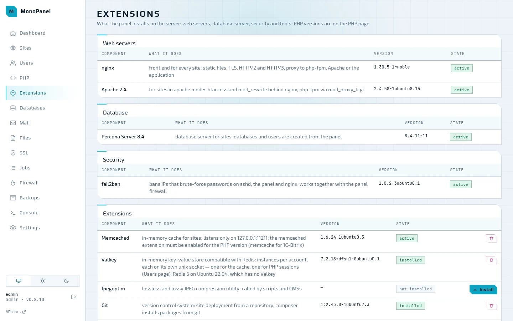

Everything the panel installs on the server besides PHP: nginx and Apache, Percona Server
or MySQL, fail2ban, memcached, Valkey, jpegoptim, git, composer and Sphinx for 1C-Bitrix —
with the version, the service state and install buttons; the tools can also be removed.
An installed component can be reinstalled — that is how a broken one is repaired, and how
composer is updated; a failed installation can be retried, and the reason is shown in its
row. Apache shows "N of M running" instead of one service's state: every account with
sites in apache mode has an Apache of its own, and the row tells whether all of them run.
While the move of the sites onto their accounts' Apaches after an upgrade from 0.8.19 has
not finished, the row also gives the number of sites that wait and the state of the
shared `apache2.service` that serves them (the tag's tooltip explains); stopped, it is
red: those sites answer 502. The PHP branches are listed here too, with the state of
their php-fpm, and are managed on the PHP page. The memory and the number of connections
for memcached are set here as well.

When a component's repository has a newer version than the installed one, the version
carries a "→ new version" tag (the tooltip says where from) and the row an Upgrade
button. When updates of nginx, PHP or Apache wait, a banner above the list offers
"Upgrade nginx, PHP and Apache" and says when the daily upgrade will install them, or
that it is off, with a link to Settings. The panel
asks before an upgrade and explains what restarts; the database server is upgraded only
with its own button, as its restart is downtime for the sites. The PHP branches are
upgraded together. A service still running the binary an upgrade replaced is marked: the
new version takes effect after a restart. The Upgrade button also shows on a row whose
service (or one of the accounts' Apaches) runs such a binary (apache2 upgraded by
unattended-upgrades, say): there is nothing to install, and the service restarts after
its configuration check. How an upgrade goes: [01 §9](01-architecture.md#9-packaging-installation-updates).

## Databases

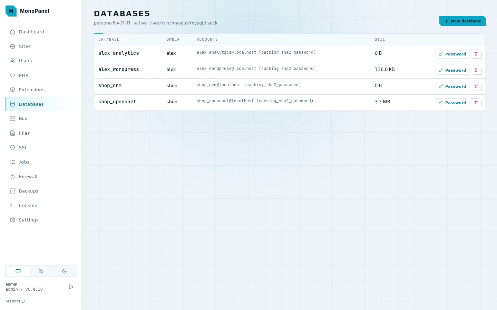

Databases are named `<login>_<name>` (MySQL limits the name to 32 characters, and the
form shows it in full), and each has its own MySQL user. The password is generated so
that it passes `validate_password`, or you set your own; a new password is set right from
the list, and a generated one is shown once. The authentication plugin is chosen when the
database is created: by default `mysql_native_password` if the owner has a site on PHP
below 7.4, otherwise `caching_sha2_password`; only an administrator can switch
`mysql_native_password` on for the server, since that restarts MySQL. Above the table:
which database server is installed, where its socket is and whether
`mysql_native_password` is on; while there is no database server, an administrator
installs Percona Server or MySQL 8.4 from here. Below, for an administrator, are the MySQL
settings: the panel's values, sized for the host's memory, and the ones set by hand, like
`mp db config`; saving restarts MySQL after checking the configuration, and "Retune for
this host" recalculates the panel's values.

Below, an administrator finds phpMyAdmin: whether it is installed, its address (a port of its own, 2083 by default,
with the panel's name and certificate), its release and PHP branch; it is installed, moved to another port or PHP
branch and removed here. Once it is installed, every database gets a "phpMyAdmin" button: it opens the database in a
new tab signed in — as a temporary MySQL account on that database only, for 8 hours or until you sign out; the link
works once, within a minute. A user keeps at most three such sessions per database (a fourth press ends the
oldest); deleting the database or the account ends them at once. The ordinary phpMyAdmin login takes a database
user's name and password.

## Mail

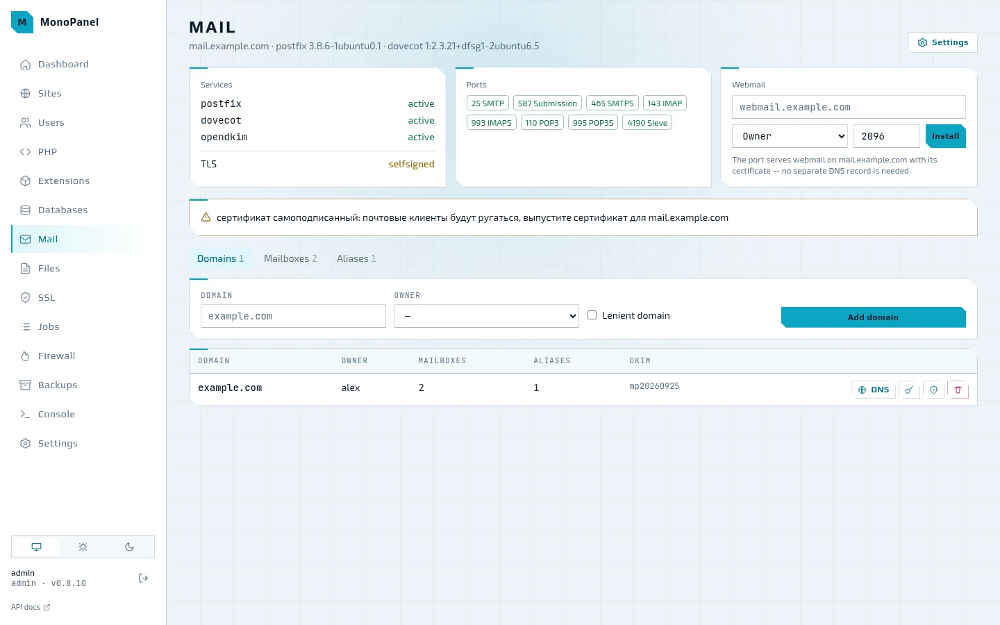

The state of postfix, dovecot and opendkim, the certificate, open ports (and ones taken
by a foreign daemon), Roundcube webmail, domains, mailboxes and aliases; mailboxes and
aliases can be shown for one domain. A domain's DNS button shows which MX, SPF, DKIM,
DMARC and PTR records to publish and checks them against public resolvers. A domain's row
has a new DKIM key, "send only", the lenient domain mode, switching off and deletion; a
mailbox's row has editing of its name, quota (0 — no limit), password and state, a new
random password and deletion, optionally with the messages; an alias's row has editing of
its destinations. An administrator installs the mail server, changes its settings,
applies the configuration again ("Apply now") and installs the webmail or reinstalls it
over itself — the Roundcube database with the users' contacts and settings stays. If the
mail server runs on a self-signed certificate, the panel warns about it (on EL STARTTLS
on 587 does not work then — issue a certificate for the mail host name on the SSL page).
DKIM switched on in the settings after the mail server was installed without it works
once the mail server is installed again (`mp mail install`,
[06 §12](06-mail.md#12-limitations)). More in [06. Mail server](06-mail.md).

## Files

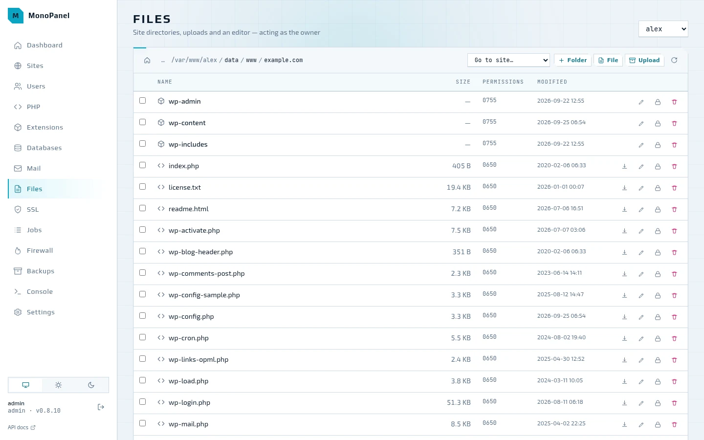

Files are opened as their owner: the panel sees in them exactly what the owner sees.
Upload (drag-and-drop too), new files and folders, renaming and moving to another path,
permissions, extraction of zip and tar (tar.gz), download, deletion — of several at once
as well — going to a path or to a site's directory, and a folder's size on request; a
symlink to a directory opens as a directory. An administrator picks the account, and on
a site's page the "Files" tab opens straight at its docroot.

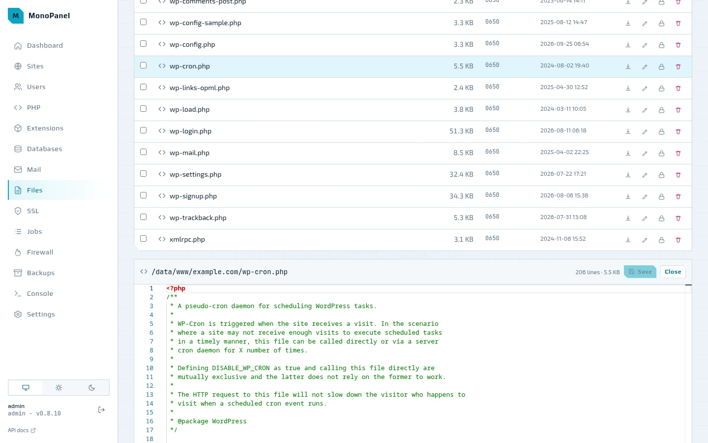

A text file opens in the VS Code editor (Monaco): highlighting for php, html, css, js,
sql, yaml and ini, find and replace, multiple cursors, folding, the command palette on F1.

## SSL

All the server's certificates on one administrator's page. At the top is the panel's own
certificate: self-signed, issued over ACME (HTTP-01 or DNS-01, an ECDSA P-256 or RSA-2048
key, staging if wanted) or imported; it can be renewed, or the self-signed one put back.
While the panel has only an address and no name, none can be issued — the name is set in
Settings. Below are the sites: which certificate serves their HTTPS and whether it covers
all of a site's names, the issuer and the expiry; a site's certificate is issued,
imported (a bought or corporate one, with its chain; the PEM is pasted as text or loaded
from a file) and renewed from its row. A Let's Encrypt certificate the panel then renews
itself, any other it does not: a new one goes in the same way, by import. "Other
certificates" are those served by neither the panel nor the sites, such as the mail
host's: they are ordered for any names — wildcards through DNS-01 — from Let's Encrypt,
its staging or another ACME directory, imported and deleted. At the bottom are the DNS
providers for DNS-01: the fields are lego's variables for that provider, and the values
are stored encrypted and never shown again. "Renew all" orders new ACME certificates
right away; "Details" shows the names, the serial number, the validity, the last attempt
and what serves the certificate.

## Jobs

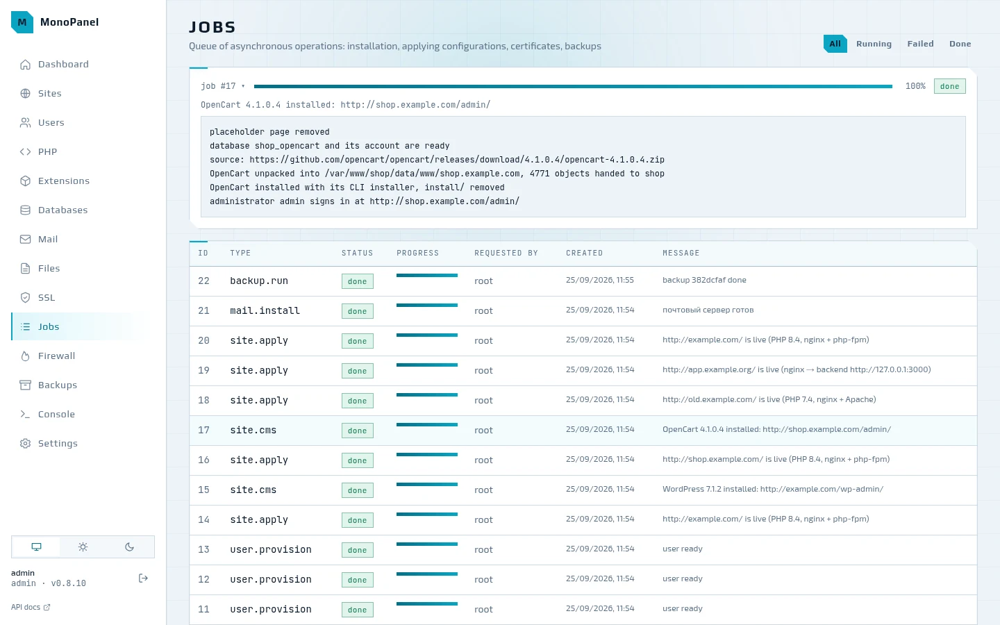

Everything that changes the server goes through the job queue: installing packages,
applying sites, issuing certificates, backups. The list is filtered by status and by how
many of the latest jobs to show (up to 500), and a job beyond it is opened by its number.
A click opens the job's target, times, parameters and log — live while the job runs;
passwords, tokens and secrets in the parameters are not shown. A failed job stays in the
list with its error text. An administrator sees every job, an account the ones it
started.

## Audit log

Who signed in to the panel and from where (failed attempts too), who created tokens,
who changed what, whose requests to the local socket were refused. An administrator
sees everything, an account only its own entries. The filters are sign-ins, tokens,
refusals, the account (for an administrator), the start of the action (`auth.`,
`token.`, `site.`…) and the number of latest entries; a click on an account or an action
in the table filters by it, and a click on the details expands them. The same is
`mp audit`, and for incident reviews with files there is `/var/log/monopanel/audit.log`
in JSON lines.

## Firewall

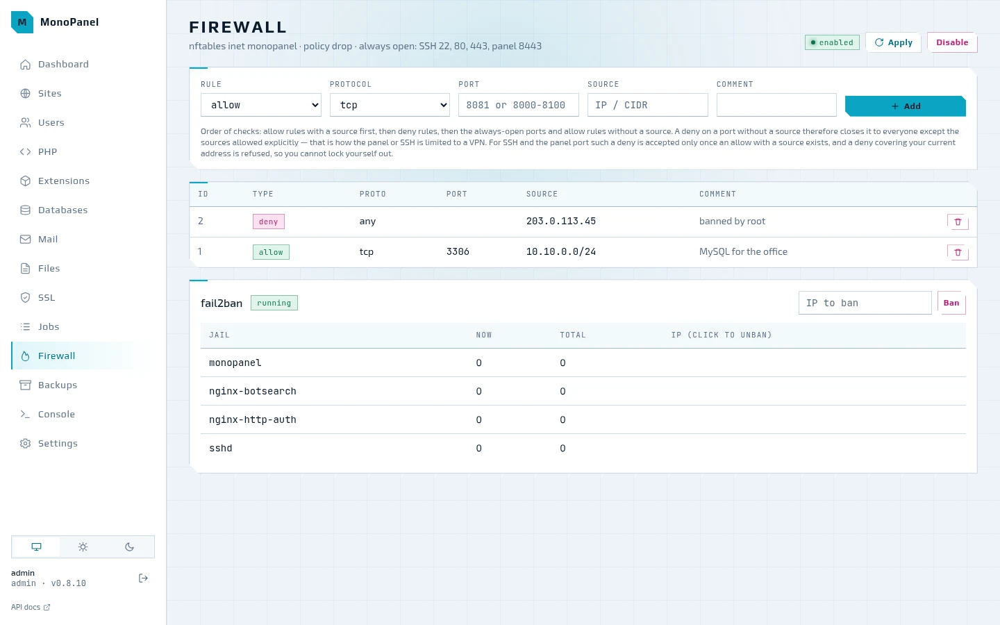

Firewall rules in nftables on top of a drop policy; SSH, 80, 443 and the panel port are
always open. Allow rules with a source are checked before deny rules, so a port can be
closed to everyone except your own network or VPN, and the panel will not accept a rule
that would lock you out. A rule is allow or deny, a protocol, a port or a range, a source
and a comment; the closed ports and whom they are open to are shown as tags. The buttons
at the top apply the firewall again, enable and disable it, and if its nftables table is
not loaded, the page warns about it. Below are the fail2ban jails and their bans; an
address is unbanned with a click, and an address can also be banned or unbanned by hand
(a ban is a deny rule of the panel's firewall, and your own address cannot be banned);
fail2ban, if missing, is installed from here too. Under them are the trusted addresses:
fail2ban never bans those — the office and the administrators' addresses go there; the
list is kept even before fail2ban is installed.

## Services

The systemd units the panel watches — the agent, nginx, the Apache of every account with
sites in apache mode (`monopanel-apache@<login>`), the database server and the php-fpm of
every installed PHP branch — with their state, autostart and start time;
any other unit of the server opens by name (postfix, dovecot, fail2ban, a timer or a
socket). A unit has start, stop, restart, reload (re-read the configuration) and "Reload
or restart", and its autostart is enabled or disabled, like `mp service …`; its systemd
journal has the number of last lines, a text filter and a refresh every 5 seconds.
Before a stop the page says what will stop working: for nginx every site, for the
database server the databases, for `monopanel-api` and the agent the panel itself; the
page survives a restart of the panel and reconnects by itself. Stopping `monopanel-api`
leaves the port to its socket, `monopanel-api.socket`, and the next connection starts the
panel again; a restart of the socket itself is carried out as a stop of it and a restart
of the API. Stopping `monopanel-api.socket` itself leaves the API running on its copy of
the port, but once the API stops or crashes nothing holds the port: the diagnostics'
"api socket" line warns of it, and a restart of `monopanel-api` brings the socket back.
Instances of template units (modprobe@…, getty@…), targets, slices, devices
and scopes, as well as debug-shell, emergency, rescue, console-getty, the power units
(systemd-halt, -poweroff, -reboot, -kexec, -soft-reboot, -exit, -suspend, -hibernate,
-hybrid-sleep, -suspend-then-hibernate), systemd-sysext/confext and systemd-tmpfiles-*
only report their state: the agent takes no action on them; the accounts' Apaches
(`monopanel-apache@<login>`) are the exception. The panel's own runs — its self-update,
`monopanel-update.service`, and the package manager, `monopanel-pkg-<run>.service` (they
open by name while they run; a stop would break a dpkg/rpm transaction off halfway) —
only report their state too, and a mount unit below the web root the agent never starts,
reloads or enables: such units are for `systemctl`. While the site log tree `sites/` is
not root's alone or not cleared, the agent refuses to start, restart or reload php-fpm,
nginx and Apache, and to install, upgrade or remove packages (PHP and stack installation
jobs fail with that reason); while the socket directory `/run/monopanel/php` is not root's
alone, it refuses the same for php-fpm and the packages. It says the agent should be
restarted, and a site log tree not cleared yet it tries to clear again before each such
action. The page shows an agent's refusal with its reason (the API answers 403, not 502).
The page is for administrators.

## Backups

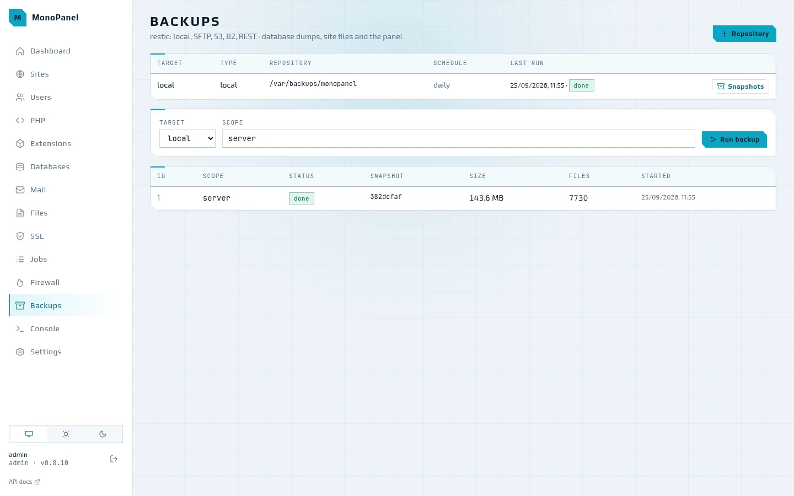

Backups go to restic repositories — a local directory, SFTP, S3, B2 or a REST server —
with a schedule (daily or weekly at a set time of the server's clock, backing up the whole server, an
account, a site or a database as a run by hand does; the
pencil button changes it and the retention on an existing repository) or manual runs and
retention by days, weeks and months; the repository password is generated and shown once, and the S3, B2 and REST
credentials are stored encrypted. A backup can be run for the whole server, an account, a
site or a database; a snapshot is restored alongside, into `/var/lib/monopanel-agent/restore/<snapshot>`
(root's alone), or in place after an explicit confirmation. What to restore is chosen as
for a backup: an account (its home and its databases), a site, a database (in place its
dump is loaded back as the database's own account) — the panel finds the paths and dumps
in the snapshot — or "pick from the snapshot": the snapshot opens a directory at a time,
and the directories or single files needed are ticked (in place: in the web root, the
panel's configuration, certificates, the ACME account and dumps); what the snapshot was taken of is preselected. Before an in-place restore the agent checks that the file system the files
go back to has room: the snapshot is first staged next to them, in a directory of the
agent's on that file system. When there is not enough, the job fails at once, saying how
much it takes and how much is free. A restore aside is checked for room too — in
`/var/lib/monopanel-agent/restore`, on its file system — and refused at once when it is
short: choose only the paths needed. A snapshot with device files, FIFOs, sockets or
set-user-ID / set-group-ID files in the paths chosen is restored neither in place nor
aside: the job fails at once, naming the first such file — choose the paths without it.
While an in-place restore runs, no shared folder is bound or unbound: a change of a
folder waits up to 30 seconds, then is refused — try it again once the restore is done.
Below is the history of runs, for all repositories or one, with their size and number of
files. A repository can be forgotten: the panel stops writing to it and forgets its
password, and the snapshots in it stay — they can be read again by adding the repository
back with the same password.

restic runs in a sandbox ([01 §7](01-architecture.md#7-security)). A run in which restic
could not read some files (exit code 3: a file vanished during the backup or the sandbox
refused it) is marked `partial`: the snapshot is there and restores, and below the status
are how many paths it lacks and which. For SFTP, root's key and the server's entry in
`/root/.ssh/known_hosts` are set up beforehand
(`ssh-keyscan -H <host> >> /root/.ssh/known_hosts`): the agent has `/root` read-only, and
ssh refuses an unknown host key. S3/B2/REST credentials go in the target's variables, and
a private CA for a REST server goes into the system store (`update-ca-certificates` /
`update-ca-trust`): root's own files such as `~/.aws/credentials`, or a `RESTIC_CACERT`
outside the system directories, are out of the sandbox's reach. A local repository is a
directory of restic's own (such as `/var/backups/monopanel`): the agent refuses one that
holds other files too. When `mp doctor` says a backup follows the symlinks in the trees
it saves, or that restic reads `resolv.conf` by inode, the agent is not allowed to mount
(usually a container's profile): a server backup is then guarded by Landlock alone, and a
remote repository loses DNS if the host replaces `resolv.conf` during a backup. On Oracle
Linux's UEK, which has Landlock built in but not enabled, the line says how to turn it
on. If `mp doctor` says "restic does not start in its sandbox", backups fail with that
same error: the line names what the sandbox kept from restic — report it to the panel's
developers and upgrade the panel once a release fixes it. The dashboard's diagnostics
block counts it as a failure. "restic took too long to start in its sandbox" is a
warning: the test did not finish within 30 seconds, as on a host too busy at that moment;
the agent runs it again 10 minutes later, and if it keeps timing out, backups hang the
same way — the line says what to look at.

## Migration

Moving an account between servers, an administrator's page; how it works is in
[07. Migration between panels](07-migration.md). The "Hand an account over" tab is for
the old MonoPanel: the account, a lifetime from 1 to 168 hours, "Issue a token". The
panel shows its address, the account, the token (once) and a ready `mp migrate plan …`
command, and below, the migration tokens this administrator has issued: when, until when
each is valid, and whether the new panel has used it yet; revoke the token as soon as the
move is over.
The "Move an account here" tab is for the new server. The source is another MonoPanel
(the address, the account and the token; an `mp migrate plan …` line pasted into the
address field fills the form by itself), FASTPANEL or BitrixVM (ssh as root: a password,
a private key or both, and for BitrixVM the domain of the main site), and, if needed,
another login here. "Check" shows the dry run and changes nothing: what stands in the way
— with a link to where it is fixed — warnings, the source's notes, the fingerprint of its
ssh host key, the sites (their own nginx directives behind the "own nginx" button: the
panel will not apply them but keep them for review), databases, mail, certificates, the
whole crontab that will move, app services and Valkey. "Move the account" queues the job,
and once it is done the page gives `curl --resolve` and `hosts` lines for checking the
sites before the DNS switch; for an account from a foreign panel it reminds you to set a
password for signing in to the panel.

## Console

`mp` commands as the administrator, with the output arriving as the command runs: the
same binary and the same commands as over SSH, buttons for frequent commands, a history
and an "Abort" button. Every command gets a one-time token that lives while it runs, 30
minutes at most; it receives the panel's address and the token through the environment,
and passwords and tokens typed in the line on stdin, not on its command line; the audit
log and the command's echo hide their values. The binary's service roles (`api`,
`agent`, `helper`, `fsop`, `update-run`, `app-exec`, `sandbox-exec`), `setup`, `update trust` and
whatever reads or writes files on the server (`files get|put`, `ssl import`,
`ssl panel import`, `site nginx --set`, `migrate --key`) are not available in the
console — the panel's pages do the same.

## Users

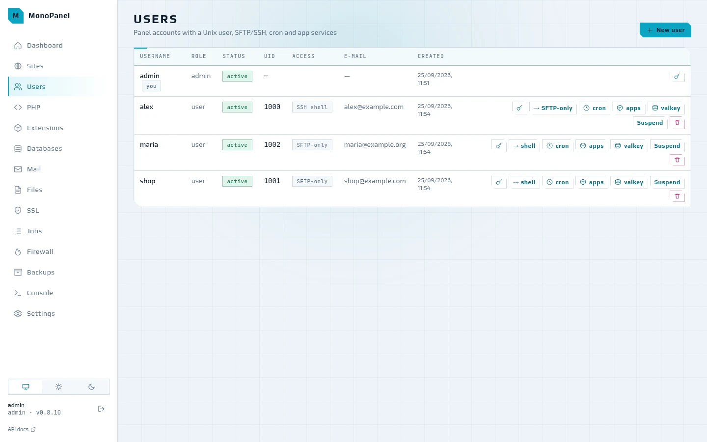

A panel account is a unix user with its own home directory: SFTP (chroot) or SSH access,
cron jobs (added, edited in place and switched off) and app services — background applications such as a bot or a Node or Python
backend under systemd, with a journal, details and editing in place. The panel and SFTP
share one password; it can be generated, and changing it ends the account's browser
sessions — its API tokens keep working; one's own password is changed with the current one. A new account takes a login, a password, an
e-mail, a role, a quota (only stored so far) and SSH access. An account's row has its card
(e-mail, UID, home directory, 2FA reset), the password, switching SFTP ↔ shell, cron, app
services, Valkey, shared folders, API tokens, suspension (sign-in to the panel is closed
and the sessions end, while SFTP/SSH, sites, databases and cron keep working) and
deletion, which asks you to type the login. The "Cron", "App services" and "Valkey" tabs
show the same for all accounts at once. Deleting an account also removes its sites,
databases, cron, app services, Valkey instances and certificates, and with the box ticked
its home directory with all the files too.

The "folders" button is for shared folders: a folder of another account's site,
bind-mounted into this account's home (for an account with a shell in
`/var/www/.shares/<login>`, with a symlink in the home; the "In the home" column shows the
path in the home). The guest sees it after signing in over SFTP and
nothing else, both accounts and the web server read and write the files, and the "no
PHP" box stops the site from executing scripts uploaded there. The "entry point" box (and the
"entry point" button in the table) makes the SFTP session start right inside the folder
instead of the home. That is how a contractor or an exchange service gets one folder of a
site without getting the account. The panel's agent binds the folders, after a reboot at
the panel's start. The table shows whether a folder is mounted; one the agent refused to
bind (its owner swapped it for a symlink, the guest or the owner is in a system group)
shows as not mounted, with why: once that is fixed, "Fix files" on the site
(`mp site fix`) or the panel's next start binds it ([10](10-shared-folders.md)).

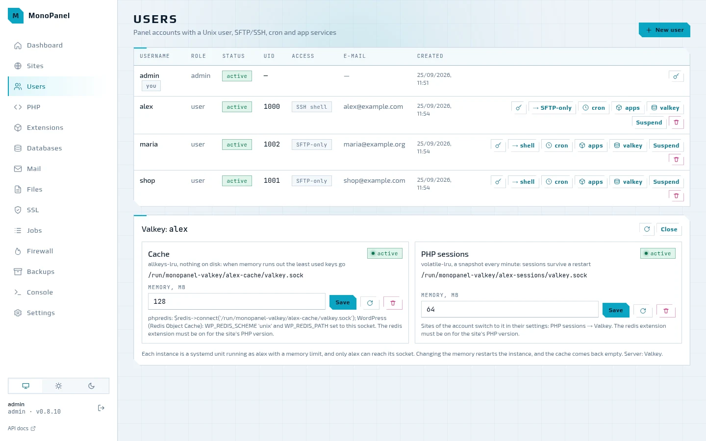

The valkey button opens the account's two Valkey instances — one for the cache and one for
PHP sessions. Each runs as the account with a memory limit and listens only on its own
unix socket: the path and a hint on how to connect phpredis or WordPress are shown right
there. A site moves its sessions to Valkey in its own settings — the "PHP sessions" field.

## Account

Instead of "Users", an ordinary account sees the "Account" page — its own things and
nothing else. At the top is its card: login, role, access (SFTP or SSH), e-mail (which it
can change), UID, home directory and the password change, which takes the current password
(its other browser sessions end, this one stays). Below are the "Cron", "App services" and "Valkey" tabs with the same
actions as an administrator has, but for itself only, "Shared folders" — folders of other
accounts' sites given to this one (an administrator gives and takes them) — and "API
tokens". Two-factor authentication is in "Settings".

## Settings

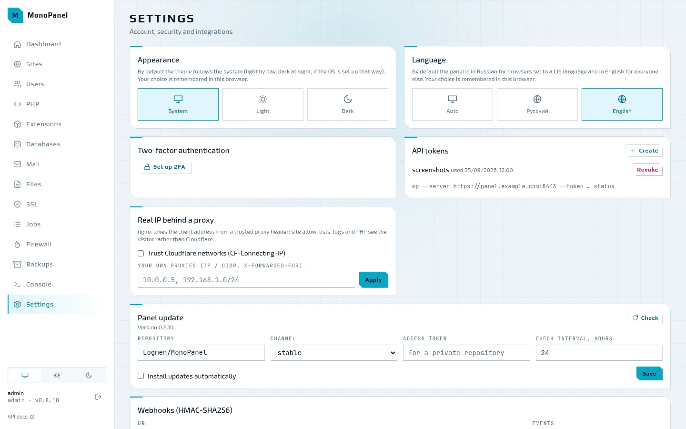

Theme and language, two-factor authentication with a QR code for the authenticator app
(and the key for typing it in by hand) — it is switched off only with the account's
password and set up anew only after that — and API tokens for the CLI and integrations:
name, lifetime and labels. An administrator also has the "Panel" card: the panel's name
(`web.hostname`), address and port (`web.listen`), how many jobs run at once
(`jobs.workers`), and the log level and format (`log.level`, `log.format`) from
`config.yaml`. They take effect when `monopanel-api` restarts, which can be done right
away; if the panel's address changes, the page shows the new one beforehand, together
with the command root runs to put the old value back. When the address changes, the
restart also moves `monopanel-api.socket`, which holds the panel's port while the API
restarts. Below are the panel update (check,
install the new or any other version, repository, channel, token, schedule and automatic
installation; the release signing key is changed only on the server, `mp update trust`;
when an install rolled back while the package database lists that version already, the
card says that updating to it installs it once more — the panel does not retry it on its
own),
webhooks signed with HMAC-SHA256 with a test delivery, trusted proxies for the visitor's
real address (Cloudflare's networks are built in), the "Daily upgrade of nginx, PHP and
Apache" card (on or off, the hour in server time, when it runs next and how the last run
ended: what was upgraded, or the error in one line, all of it in the job whose number is
shown there; the database server is not upgraded this way),
the SELinux mode on EL, and the list of configuration templates — which of them are
overridden by files in `/etc/monopanel/templates/`.

## How to retake the screenshots

The screenshots are taken from a real panel on a [testbed](08-testbed.md) machine filled
with sample data: `scripts/screenshots/seed.sh` installs the latest release with the same
command as in the README, brings up the stack and creates accounts, sites with WordPress
and OpenCart, databases, cron, mail, the firewall and a backup on example.com; the site
addresses come from the range reserved for documentation.
`scripts/screenshots/capture.mjs` opens the panel in headless Chrome with a temporary API
token and captures every page in the light and the dark theme into `docs/img/`; with
`--lang en`, the English interface goes into `docs/en/img/` for the English documentation.

```bash
make testbed-reset VM=ubuntu2404
ssh mp-ubuntu2404 sh -s < scripts/screenshots/seed.sh
node scripts/screenshots/capture.mjs --ssh mp-ubuntu2404          # all pages
node scripts/screenshots/capture.mjs --ssh mp-ubuntu2404 jobs     # just one
node scripts/screenshots/capture.mjs --lang en --ssh mp-ubuntu2404  # English
```

Next to each screenshot lies its dark variant (`<name>.dark.webp`): the documentation site
shows the one that matches the selected theme, GitHub shows the light one.
